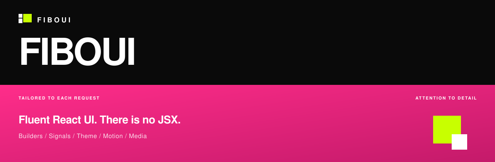
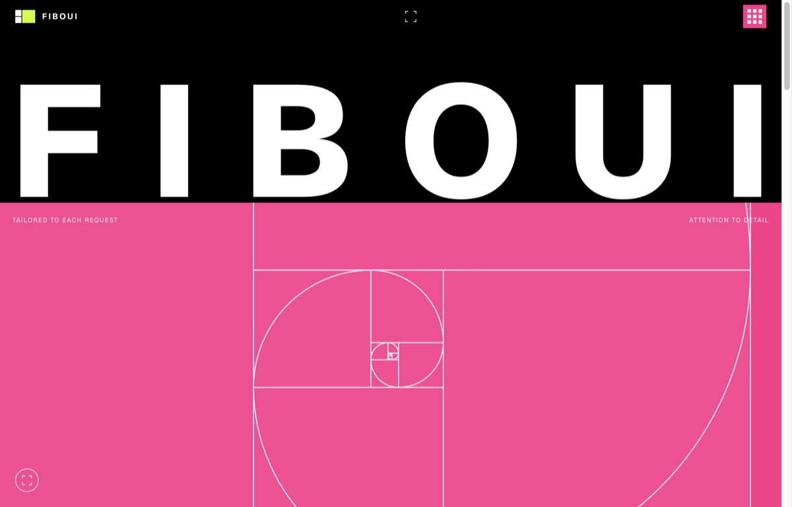
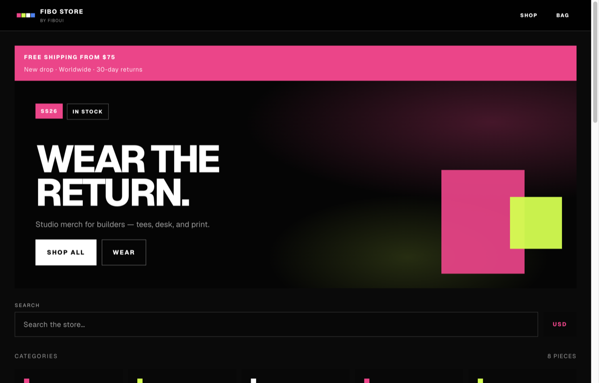
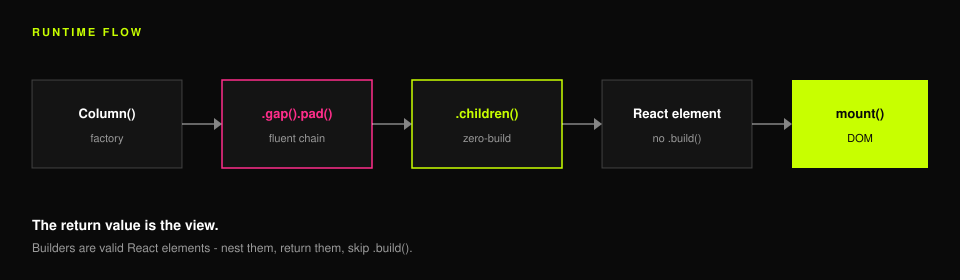
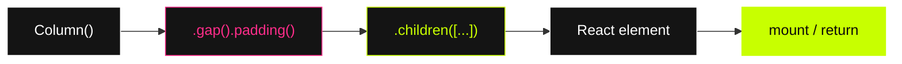
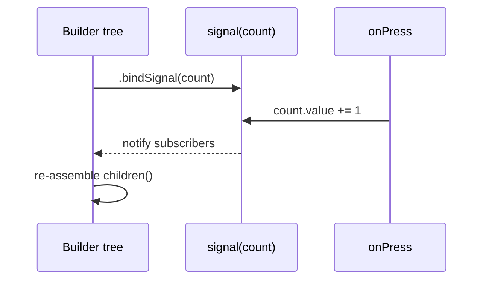
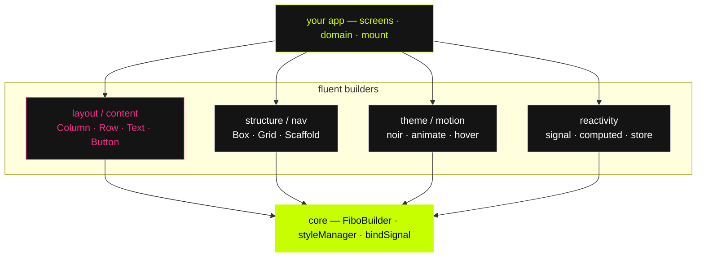
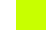

<div align="center">


# FiboUI

**Fluent React UI.** Flutter & SwiftUI energy for the web.  
There is no JSX — the function return **is** the view.

<br />

[](https://www.npmjs.com/package/fiboui)
[](https://www.npmjs.com/package/fiboui)
[](https://github.com/felipeoliveiradev/fiboui)
[](https://fiboui.vercel.app)

<br />



</div>

---

<div align="center">

### Live product

| Marketing site | Store demo |
| :---: | :---: |
| [](https://fiboui.vercel.app) | [](https://fiboui-store.vercel.app) |
| [**fiboui.vercel.app**](https://fiboui.vercel.app) | [**fiboui-store.vercel.app**](https://fiboui-store.vercel.app) |

Both ships are built **only** with FiboUI fluent builders — no JSX in the product UI.

</div>

---

## Install

```bash
npm install fiboui
```

```tsx
import 'fiboui/style.css' // required once — JS does not load CSS
import { Button, Column, Text, mount } from 'fiboui'

function App() {
  return Column()
    .gap(12)
    .padding(24)
    .children([
      Text('Hello FiboUI').variant('h1'),
      Button('Ship it').onPress(() => undefined),
    ])
}

mount('#root', App)
```

ESM-only · React **18 / 19** · Next App Router → `'use client'` on files that call builders.

---

## JSX vs FiboUI

```tsx
// ── JSX ──────────────────────────────────
<div className="flex flex-col gap-3 p-6">
  <h1>Hello</h1>
  <button onClick={onShip}>Ship it</button>
</div>

// ── FiboUI ───────────────────────────────
Column()
  .gap(12)
  .padding(24)
  .children([
    Text('Hello').variant('h1'),
    Button('Ship it').onPress(onShip),
  ])
```

Same tree. Method calls instead of tags. Layout, theme, motion, and reactivity stay on the builder.

---

## Runtime flow





Builders **are** valid React elements (`isValidElement(Button('Go'))`).  
Return them. Nest them. **Skip `.build()`.**

---

## Signal flow


```tsx
import { Box, Button, Text, signal } from 'fiboui'

const count = signal(0)

Box()
  .bindSignal(count)
  .children(() => [
    Text(`Count: ${count.value}`),
    Button('+').onPress(() => {
      count.value += 1
    }),
  ])
```

`.bindSignal` re-assembles. Read `.value` inside a **function child** so updates are live.



---

## Package architecture




---

## Why FiboUI

| | |
| :--- | :--- |
| **Assembly pattern** | Factories return builders for endless chaining |
| **Zero-build children** | Pass builders to `.children()` — they finalize implicitly |
| **Signals** | `signal()`, `computed()`, `.bindSignal()`, `.observer()` |
| **Themes** | `.theme("noir")` · `extendTheme` · Material / Cupertino / Web / Noir |
| **Motion** | `.animate('fadeIn')` · `.onScroll` · `.hoverEffect` · CSS-first |
| **Type-safe** | TypeScript builders · `FiboChild` / `FiboChildren` |

### Themes & motion

```tsx
Box()
  .theme('noir')
  .animate('fadeIn')
  .ease('spring')
  .hover((h) => h.effect('sweepToRight'))

Box().padding(8).md({ padding: 16 }).lg({ padding: 24 })
```

### Layout notes

FiboUI **2.x** matches Flutter / SwiftUI: `Column` defaults to `crossAxisAlignment('center')`.  
`Row` uses `align-self: stretch` so `spaceBetween` still fills width.

```tsx
Column().crossAxisAlignment('stretch')
```

`Button` uses **`.onPress`** (not `onClick`).

---

## Brand

<div align="center">


<br /><br />

| Token | Hex | |
| :---: | :---: | :--- |
| **Ink** | `#0a0a0a` | background |
| **Chalk** | `#ffffff` | type |
| **Pink** | `#ff2d8a` | energy |
| **Lime** | `#c8ff00` | mark / CTA |



**Tailored to each request** · **Attention to detail**

</div>

---

## Docs & contributing

| | |
| :--- | :--- |
| Migration from 1.x | [MIGRATION.md](./MIGRATION.md) |
| Contributing & release | [CONTRIBUTING.md](./CONTRIBUTING.md) |
| Animation guide | [`docs/guide/animation.md`](./docs/guide/animation.md) |
| Brand assets | [`docs/brand/`](./docs/brand/) |

Publishing is automated on **`main`** (GitHub Actions + `NPM_TOKEN`). Prefer not to `npm publish` locally.

---

<div align="center">



<br /><br />

**Wear the return.**

MIT © 2025–2026 FiboUI

[Site](https://fiboui.vercel.app) · [Store](https://fiboui-store.vercel.app) · [npm](https://www.npmjs.com/package/fiboui) · [GitHub](https://github.com/felipeoliveiradev/fiboui)

</div>
