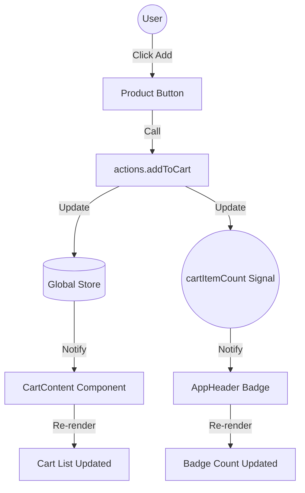

# State Management

FiboUI provides a powerful and flexible state management system built directly into the builder pattern. Choose from multiple reactive paradigms to fit your needs.

## Overview

FiboUI offers **5 state management patterns**:

1. **Signals** - Fine-grained reactivity for primitive values
2. **Computed** - Derived state that updates automatically
3. **Observables** - Reactive objects with change detection
4. **Store** - Global state management
5. **Provider/Consumer** - Context-based state sharing

---

## Signals

Signals are reactive primitive values that automatically update components when changed.

### Basic Usage

```typescript
import { signal } from 'fiboui'

const count = signal(0)

count.value          // read
count.value = 5      // write (same as today)
count.set(5)         // write
count.change(8)      // write
count.change((n) => n + 1)  // updater
count.reset()        // back to 0

Box()
  .bindSignal(count)
  .children(() => [
    Text(`Count: ${count.value}`),
    Button()
      .text('Increment')
      .onPress(() => count.change((n) => n + 1))
  ])
```

`.value =`, `.set()`, `.change()`, and `.reset()` all go through the same notify path. A static `.children([...])` array still freezes the number at build time.

`listSignal` keeps `.update(id, patch)` as the item patch. `.reset()` on a list restores the array you passed to `listSignal(...)`.

Signals live in memory on the client. Do not read or write them during SSR to persist UI — wrap reactive trees in Client Components (`'use client'`). Subscriptions are cleaned up on unmount (including React StrictMode double-mount).

There are two store APIs:

- `createStore()` + `useReactiveStore(store)` — reactive object store (`useReactiveStore` from `fiboui` and `fiboui/core`). `fiboui/core` does **not** export `useStore`.
- `@Store()` class decorator + `useStore(StoreClass)` — the public `useStore` from the `fiboui` package root.

### How it Works

```
┌─────────────┐
│ signal(0)   │ ← Create signal
└──────┬──────┘
       │
       ▼
┌─────────────────────┐
│ count.value = 5     │ ← Update value
└──────┬──────────────┘
       │
       ▼
┌─────────────────────┐
│ Notify subscribers  │ ← Trigger callbacks
└──────┬──────────────┘
       │
       ▼
┌─────────────────────┐
│ Component re-render │ ← UI updates
└─────────────────────┘
```

### When to Use

✅ Counter values
✅ Toggle states
✅ Form field values
✅ Any primitive that changes frequently

---

## Computed Signals

Computed signals are derived values that recalculate automatically when dependencies change.

Computed values are lazy: the first `.value` read attaches the internal effect and computes. Read the computed (or bind it) so dependents stay subscribed.

### Basic Usage

```typescript
import { signal, computed } from 'fiboui'

const price = signal(100)
const quantity = signal(2)

// Computed value
const total = computed(() => price.value * quantity.value)

console.log(total.value)  // 200

quantity.value = 3
console.log(total.value)  // 300 ← Updated automatically!
```

### Chaining Computed Values

```typescript
const subtotal = computed(() => price.value * quantity.value)
const tax = computed(() => subtotal.value * 0.1)
const total = computed(() => subtotal.value + tax.value)

// All update automatically when price or quantity changes
```

### Shopping Cart Example

```typescript
const cart = signal([
  { name: 'iPhone', price: 999, quantity: 1 },
  { name: 'MacBook', price: 2499, quantity: 1 }
])

const cartTotal = computed(() => {
  return cart.value.reduce((sum, item) =>
    sum + (item.price * item.quantity), 0
  )
})

Box()
  .bindSignal(cartTotal)
  .children(() => [
    Text(`Total: $${cartTotal.value}`)
  ])

```

### Performance Benefits

```typescript
// ❌ Function - Recalculates every time
const getTotal = () => cart.value.reduce(...)

// ✅ Computed - Caches result
const total = computed(() => cart.value.reduce(...))

// Called 100 times = only 1 calculation
for (let i = 0; i < 100; i++) {
  console.log(total.value)  // Uses cached value
}
```

### When to Use

✅ Filtered/sorted lists
✅ Form validation
✅ Calculated totals
✅ Formatted values
✅ Any expensive computation

---

## Observables

Observables are reactive objects that notify listeners when changed.

### Basic Usage

```typescript
import { observable } from 'fiboui'

const user = observable({
  name: 'John',
  email: 'john@example.com',
  age: 25
})

Box()
  .observe(user)
  .children(() => [
    Text(`Name: ${user.get().name}`),
    Button()
      .text('Update')
      .onPress(() => user.set({ ...user.get(), name: 'Jane' }))
  ])

```

### Multiple Observables

```typescript
const filters = observable({ search: '', category: 'all' })
const products = observable([...])

// Component only re-renders when filters change
Box()
  .observe(filters)
  .children(() => [
    TextField()
      .value(filters.get().search)
      .onChange((value) => {
        filters.set({ ...filters.get(), search: value })
      })
  ])

// Component only re-renders when products change
Box()
  .observe(products)
  .children(() =>
    products.get().map(p => ProductCard(p))
  )

```

### When to Use

✅ Form state
✅ Filter/search state
✅ Complex objects
✅ Isolated component state

---

## Global Store

Store provides centralized state management for your entire application.

### Creating a Store

```typescript
import { createStore } from 'fiboui'

interface AppState {
  user: { name: string; isLoggedIn: boolean }
  cart: CartItem[]
  theme: 'light' | 'dark'
}

const store = createStore<AppState>({
  user: { name: 'Guest', isLoggedIn: false },
  cart: [],
  theme: 'light'
})
```

### Using the Store

```typescript
// Get state
const state = store.getState()

// Update state
store.setState({ theme: 'dark' })

// Update with function
store.setState(state => ({
  cart: [...state.cart, newItem]
}))

// Subscribe to changes
const unsubscribe = store.subscribe(state => {
  console.log('State changed:', state)
})
```

### In Components

```typescript
function Header() {
  return Box()
    .observer()
    .children(() => {
      const state = store.getState()
      return [
        Text(state.user.name),
        Text(`Cart: ${state.cart.length}`),
      ]
    })
}
```

`store.getState()` must run **inside** the function child (or use `useReactiveStore(store)` in a React function). Reading the store once above `.observer()` freezes the snapshot. `.observer()` tracks reactive reads during that rebuild — it does not subscribe to every store in the app.

### Actions Pattern

```typescript
const actions = {
  login(email: string, name: string) {
    store.setState({
      user: { name, isLoggedIn: true }
    })
  },

  logout() {
    store.setState({
      user: { name: 'Guest', isLoggedIn: false },
      cart: []
    })
  },

  addToCart(item: CartItem) {
    const state = store.getState()
    store.setState({
      cart: [...state.cart, item]
    })
  }
}
```

### When to Use

✅ User authentication
✅ Shopping cart
✅ App-wide settings
✅ Shared data across components

---

## Provider/Consumer

Provider pattern for sharing values down the component tree.

### Basic Usage

```typescript
import { useProvider } from 'fiboui'

const theme = {
  primary: '#3B82F6',
  secondary: '#10B981'
}

// Provider — values are read with useProvider in a child React function
Box()
  .provide('theme', theme)
  .children([
    <ChildComponent key="child" />
  ])

function ChildComponent() {
  const t = useProvider<typeof theme>('theme')
  return Box().bg(t?.primary ?? '#3B82F6')
}
```

`.consume(key)` reads the **same builder’s** local map and returns the value (not `this`) — it does not walk parent context. Do not chain it.

### Dynamic Theme Example

```typescript
import { useProvider } from 'fiboui'

const lightTheme = { background: '#fff', primary: '#3B82F6' }
const darkTheme = { background: '#111', primary: '#60A5FA' }
const currentTheme = signal(lightTheme)

function Content() {
  return Box().children([Text('Content')])
}

function Footer() {
  return Box().children([Text('Footer')])
}

function App() {
  return Box()
    .bindSignal(currentTheme)
    .children(() =>
      Box()
        .provide('theme', currentTheme.value)
        .children([
          <Header key="header" />,
          Content(),
          Footer(),
        ])
    )
}

function Header() {
  const theme = useProvider<typeof lightTheme>('theme')
  return Box()
    .bg(theme?.background ?? '#fff')
    .children([
      Button()
        .text('Toggle Theme')
        .onPress(() => {
          currentTheme.value =
            currentTheme.value === lightTheme ? darkTheme : lightTheme
        })
    ])
}
```

### When to Use

✅ Theme configuration
✅ Localization (i18n)
✅ Feature flags
✅ User permissions

---

## Comparison Table

| Pattern | Scope | Reactivity | Performance | Use Case |
|---------|-------|------------|-------------|----------|
| **Signal** | Local/Global | Fine-grained | ⚡ Excellent | Primitive values |
| **Computed** | Derived | Automatic | ⚡ Excellent | Calculated values |
| **Observable** | Local/Global | Coarse-grained | ⚡ Good | Complex objects |
| **Store** | Global | Broadcast | ⚡ Good | Shared state |
| **Provider** | Hierarchical | Context | ⚡ Medium | Configuration |

---

## Best Practices

### 1. Choose the Right Tool

```typescript
// ✅ Signal for primitives
const isOpen = signal(false)

// ✅ Computed for derived values
const filteredItems = computed(() => items.value.filter(...))

// ✅ Observable for objects
const form = observable({ name: '', email: '' })

// ✅ Store for global state
const appStore = createStore({ user, cart, settings })

// ✅ Provider for config
Box().provide('theme', theme)
```

### 2. Minimize Re-renders

```typescript
// ❌ Static children — observer cannot re-read store.getState()
Box().observer().children([Text(store.getState().user.name)])

// ✅ Function child, or .observe(one observable)
Box().observer().children(() => Text(store.getState().user.name))
Box().observe(userObservable)
```

### 3. Use Computed for Expensive Operations

```typescript
// ❌ Bad - Recalculates every render
const filtered = items.value.filter(...)

// ✅ Good - Caches result
const filtered = computed(() => items.value.filter(...))
```

### 4. Keep State Close to Usage

```typescript
// ✅ Local state for component-specific data
Box().state('isHovered', false)

// ✅ Global store for shared data
const appStore = createStore({ user, cart })
```

---

## Practical Example: E-commerce

This complete example demonstrates how to combine all state management patterns in a real-world scenario. It uses a **Global Store** for products and cart items, **Signals** for immediate UI updates (like the cart badge), and **Computed Signals** for calculating totals.

### The E-commerce Application

```tsx
/**
 * 🛒 E-COMMERCE EXAMPLE
 * Demonstrates: Store, Signals, Computed and observer()
 */

import { Scaffold, Box, Text, Button, Badge, Row, Column } from 'fiboui';
import { signal, computed, createStore } from 'fiboui';

// 1. Data Types
interface Product { id: string; name: string; price: number; image: string; }
interface CartItem extends Product { quantity: number; }
interface AppState { cart: CartItem[]; products: Product[]; }

// 2. Global State (Store)
const appStore = createStore<AppState>({
  cart: [],
  products: [
    { id: '1', name: 'MacBook Pro', price: 2499, image: '💻' },
    { id: '2', name: 'iPhone 15', price: 999, image: '📱' },
    { id: '3', name: 'AirPods Pro', price: 249, image: '🎧' }
  ],
});

// 3. Reactive Values (Signals)
const cartItemCount = signal(0);
const cartTotal = computed(() => {
  const cart = appStore.getState().cart;
  return cart.reduce((sum, item) => sum + item.price * item.quantity, 0);
});

// 4. Actions
const actions = {
  addToCart(product: Product) {
    const state = appStore.getState();
    const existingItem = state.cart.find(item => item.id === product.id);

    if (existingItem) {
      appStore.setState({
        cart: state.cart.map(item =>
          item.id === product.id ? { ...item, quantity: item.quantity + 1 } : item
        ),
      });
    } else {
      appStore.setState({ cart: [...state.cart, { ...product, quantity: 1 }] });
    }

    // Update the signal for immediate UI feedback
    cartItemCount.value = appStore.getState().cart.reduce((sum, item) => sum + item.quantity, 0);
  }
};

// 5. Components
function AppHeader() {
  return Box()
    .bindSignal(cartItemCount)
    .bindSignal(cartTotal)
    .children(() => [
      Text('🛒 FiboShop'),
      Row().children([
        Text(`Total: $${cartTotal.value.toFixed(2)}`),
        Badge().text(String(cartItemCount.value)),
      ]),
    ]);
}

function CartContent() {
  return Box()
    .observer()
    .children(() => [
      Text('My Cart'),
      ...appStore.getState().cart.map(item =>
        Text(`${item.name} x ${item.quantity}`)
      ),
    ]);
}

function ProductSidebar() {
  return Box()
    .observer()
    .children(() =>
      appStore.getState().products.map((product) =>
        Button(product.name).onPress(() => actions.addToCart(product))
      )
    );
}

// 6. Main Application
export function EcommerceApp() {
  return Scaffold()
    .children([
      AppHeader(),
      Box()
        .display('flex')
        .children([
          ProductSidebar(),
          CartContent(),
        ]),
    ]);
}
```

### Data Flow Diagram



---

## API Reference

### signal()

```typescript
function signal<T>(initialValue: T): Signal<T>
```

Creates a reactive signal.

**Methods:**
- `.value` - Get/set the value
- `.subscribe(callback)` - Subscribe to changes

### computed()

```typescript
function computed<T>(fn: () => T): ComputedSignal<T>
```

Creates a computed signal that recalculates automatically.

**Methods:**
- `.value` - Get the computed value (read-only)
- `.subscribe(callback)` - Subscribe to changes

### observable()

```typescript
function observable<T>(initialValue: T): Observable<T>
```

Creates an observable object.

**Methods:**
- `.get()` - Get current value
- `.set(value)` - Set new value
- `.subscribe(listener)` - Subscribe to changes

### createStore()

```typescript
function createStore<T>(initialState: T): Store<T>
```

Creates a global store.

**Methods:**
- `.getState()` - Get current state
- `.setState(updater)` - Update state
- `.subscribe(listener)` - Subscribe to changes

### listSignal()

```typescript
function listSignal<T>(initial?: T[]): ListSignal<T>
```

`collection` is the same function. Each item gets an `_id` (`crypto.randomUUID`) unless one is already set.

**Methods:** `add`, `insert`, `set`, `update`, `remove` / `delete`, `find`, `search`, `clear`, `replace`, `filter`, `map`, `move`, `view`, `viewWhere`.

`update` / `remove` / `find` match `_id`, then a domain `id`, then a predicate. `search(query)` is a live `view()` plus a copy of the visible rows. `filter(fn)` is a one-shot snapshot of `_source` (does not change `.value`; safe inside `computed`). `viewWhere(fn)` is the live predicate (AND with the query); `viewWhere()` clears it. Bind `List` / `Table` to the signal itself — the array returned by `filter` / `search` is a snapshot.

```tsx
const todos = listSignal<{ title: string }>([])
todos.add({ title: 'Ship it' })

List()
  .items(todos)
  .empty('No todos')
  .renderItem((todo) => ListTile().title(todo.title))

Table().data(todos).columns([{ header: 'Title', accessor: 'title' }])

Text(`Total todos: ${todos.$length}`)
```

`List().empty(...)` paints `.fibo-list-empty` when the array / `listSignal` / `items(fn)` result is empty. `List().items(fn)` re-runs when the list rebuilds (pair with `.bindSignal`). `Table().data(listSignal)` binds the same way. `view(query)` / `search(query)` filter `.value` in place; `viewWhere(fn)` is the live predicate (AND with the query). `add` / `update` still write the full list. `const hits = todos.search('x')` is a copy. `todos.filter(fn)` is a snapshot of `_source`.

`$length` is an interpolation token, not a number. `` `${todos.length}` `` freezes. `Text`, Label, Alert, ListTile, Button, Banner, Card (`.text` / `.subtitle` / `.number` and string children), Combobox / RadioGroup / Progress labels, and field labels auto-bind the signals whose markers appear in the string. `.bindSignal(other)` adds another. Nothing subscribes to every signal in the tree.

In-place edits (`todos.value[0].title = 'x'`) do not notify. Assign through `update` / `set`.

### Builder Methods

```typescript
// Bind one signal. Only signals you pass are subscribed.
.bindSignal(signal)

// Observe an observable
.observe(observable)

// Rebuild when tracked signals / observables / stores are read
// during a function `.children(() => …)` (not a static array)
.observer()

// Provide a value for descendants (`useProvider(key)` in a child)
.provide(key, value)

// Local state
.state(key, initialValue)
.getState(key)
.setState(key, value)
```
