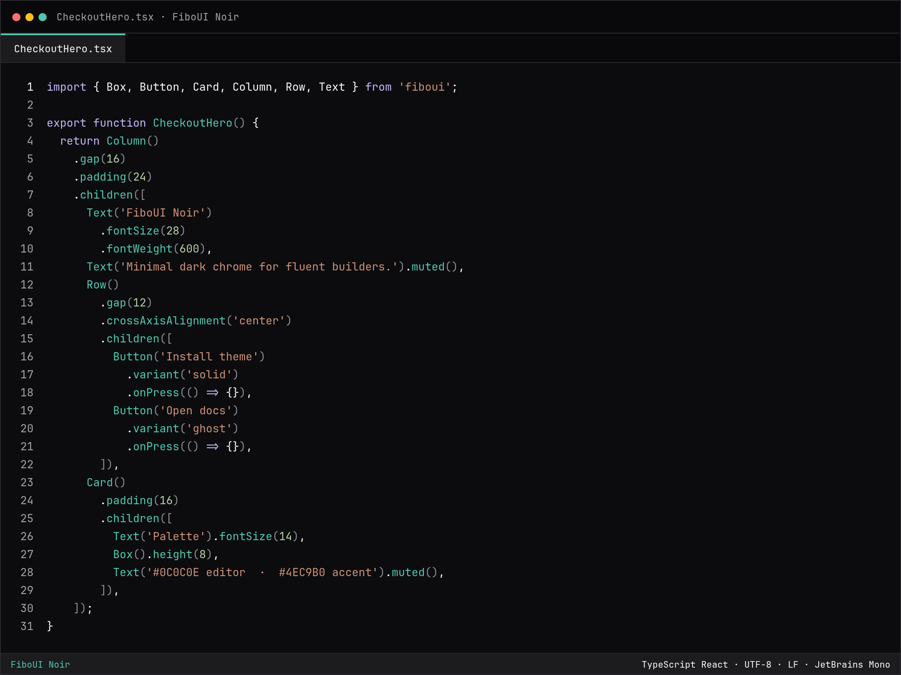
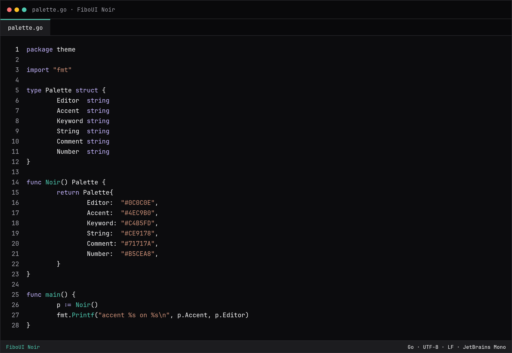

# FiboUI Noir

A dark, quiet color theme for VS Code and Cursor. Zinc chrome, one teal accent, and syntax colors that keep FiboUI fluent builders easy to scan.

The same theme still ships inside the [FiboUI editor extension](https://marketplace.visualstudio.com/items?itemName=felipeoliveiradev.fiboui). This package is the theme only, so you can install it on its own.





## Palette

Hex values come from the theme JSON in this package.

| Role | Hex |
|------|-----|
| Editor background | `#0C0C0E` |
| Workbench chrome | `#09090B` |
| Foreground | `#F4F4F5` |
| Muted / line numbers | `#A1A1AA` |
| Comments | `#71717A` |
| Functions / accent | `#4EC9B0` |
| Keywords | `#C4B5FD` |
| Strings | `#CE9178` |
| Numbers | `#B5CEA8` |
| Punctuation | `#8A8A93` |
| Selection | `#14332E` |
| Error | `#F87171` |
| Indent guides | `#3F3F46` |
| Active indent / focus | `#4EC9B0` |

Comments are italic. Indent guides and bracket-pair guides share one gray. The active guide is teal.

## Install

**VS Code (Visual Studio Marketplace)**

1. Open Extensions.
2. Search for **FiboUI Noir**.
3. Install `felipeoliveiradev.fiboui-noir`.

Command Palette:

```text
ext install felipeoliveiradev.fiboui-noir
```

CLI:

```bash
code --install-extension felipeoliveiradev.fiboui-noir
```

**Cursor (Open VSX)**

Cursor reads Open VSX, not the Visual Studio Marketplace.

1. Open Extensions.
2. Search for **FiboUI Noir**.
3. Install `felipeoliveiradev.fiboui-noir`.

If you use the Cursor CLI:

```bash
cursor --install-extension felipeoliveiradev.fiboui-noir
```

Listings:

- [Visual Studio Marketplace](https://marketplace.visualstudio.com/items?itemName=felipeoliveiradev.fiboui-noir)
- [Open VSX](https://open-vsx.org/extension/felipeoliveiradev/fiboui-noir)

## Activate

1. Command Palette → **Preferences: Color Theme**
2. Choose **FiboUI Noir**

Or set it in user settings:

```json
{
  "workbench.colorTheme": "FiboUI Noir"
}
```

Reload the window if the chrome colors do not apply on the first switch.

## Recommended font and settings

The screenshots use [JetBrains Mono](https://www.jetbrains.com/lp/mono/). Cascadia Code is a good alternative. Ligatures are optional.

```json
{
  "workbench.colorTheme": "FiboUI Noir",
  "editor.fontFamily": "JetBrains Mono, Cascadia Code, ui-monospace, monospace",
  "editor.fontSize": 14,
  "editor.lineHeight": 22,
  "editor.guides.indentation": true,
  "editor.guides.bracketPairs": true,
  "editor.bracketPairColorization.enabled": true
}
```

Bracket-pair colorization uses the same teal as functions, so nested FiboUI `.children([ … ])` trees stay aligned with the indent guides.

## FiboUI

FiboUI is a fluent UI library for TypeScript and React. Theme names in the library (`Column().theme("noir")`) and this editor theme are meant to sit together.

- Site: [fiboui.vercel.app](https://fiboui.vercel.app)
- Source: [github.com/felipeoliveiradev/fiboui](https://github.com/felipeoliveiradev/fiboui)
- Editor extras (closing labels, snippets, auto-indent): `felipeoliveiradev.fiboui`

This extension copies the canonical theme JSON from `extensions/vscode-fiboui/themes/fiboui-noir-color-theme.json` in that repo. Run `npm run sync-theme` if you edit the source copy.

## License

MIT. See [LICENSE](./LICENSE).
